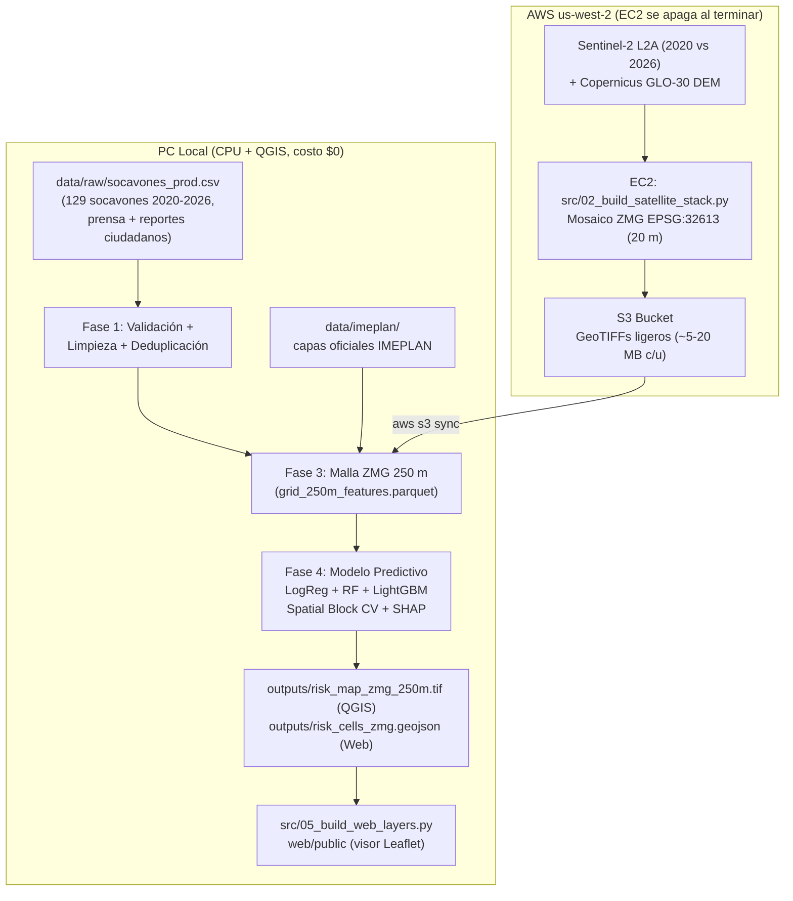

# Plan de Implementación — SocavonesGDL (Arquitectura Híbrida)

## Objetivo
Construir un pipeline geoespacial y de *Machine Learning* en **arquitectura híbrida** para predecir el riesgo de aparición de socavones en la **Zona Metropolitana de Guadalajara (ZMG)**, evaluando las tres causas principales:

1. **Cambio de uso de suelo y densificación urbana** (Sentinel-2 multi-temporal + IMEPLAN).
2. **Inundaciones y acumulación topográfica de agua** (Sentinel-2 lluvias + Copernicus DEM + Riesgo de inundaciones IMEPLAN).
3. **Saturación / falta de mantenimiento de tuberías y drenaje** (Red de drenaje municipal + Presión sobre el funcionamiento del drenaje IMEPLAN).

---

## Arquitectura Híbrida (AWS + Local)

- **AWS (`us-west-2`):** Solo se usa la EC2 para generar los GeoTIFFs satelitales (Sentinel-2 + Copernicus DEM) porque los COGs de Element 84 viven en `us-west-2`. Al terminar, se sincronizan a local (`aws s3 sync`) y la EC2 se puede **detener**.
- **Local (CPU + QGIS):** Procesamiento de CSVs, capas IMEPLAN, construcción de la malla 250 m, entrenamiento ML, análisis SHAP y visualización directa en QGIS.

---

## Inventario de Datos de Entrada (`data/raw/`)

| Archivo / Carpeta | Descripción | Notas clave |
|---|---|---|
| `data/raw/socavones_prod.csv` | **Fuente que usa el pipeline.** 129 socavones (2020–2026) de prensa y reportes ciudadanos, con coordenadas ubicadas a mano | 2 filas conservan la coordenada por defecto del mapa (`20.67, -103.35`) y se re-geocodifican con el caché de Google Maps (`data/interim/geocode_google_cache.json`). |
| `data/raw/socavones_ZMG_depurado.csv` | 131 socavones de prensa verificados (2020–2026), sin coordenadas | Fuente original; ya está integrada en `socavones_prod.csv`. |
| `data/raw/socavones_zmg_informador_2020_2026.csv` | 54 notas de El Informador (2020–2026) | Fuente original; ya está integrada en `socavones_prod.csv`. |
| `data/raw/socavones.csv` | 14 reportes ciudadanos (2026) de la plataforma | Fuente original; ya está integrada en `socavones_prod.csv`. |
| `data/imeplan/*.zip` | 9 capas oficiales de IMEPLAN (`LimiteAMG`, `Crecimiento poblacional urbano 2010-2020`, `Densidad de población`, `Espacios verdes`, `Histórico de licencias de urbanización`, `Incremento al CUS`, `Transferencia de derechos de desarrollo`, `Riesgo de inundaciones`, `Presión sobre el funcionamiento del drenaje`, `Red de drenaje municipal`) | Los scripts buscan los `.shp` dentro de `data/imeplan/`, así que antes de la Fase 1 hay que descomprimir cada `.zip` en una carpeta con su mismo nombre. Las carpetas descomprimidas se ignoran en `.gitignore` (`data/imeplan/*/`) para mantener el repo liviano. *(Nota: `Riesgo de inundaciones.zip` pesa ~145 MB y supera el límite de 100 MB de GitHub, por lo que se recomienda sincronizarlo vía S3 o Git LFS.)* |

---

## Fases del Pipeline

### Fase 1 — Validación, Limpieza y Deduplicación de Socavones (`src/01_prepare_sinkholes.py`)
- Lee `data/raw/socavones_prod.csv`, que ya une prensa y reportes ciudadanos con coordenadas ubicadas a mano.
- Las filas que conservan la coordenada por defecto del mapa (`20.67, -103.35`) se re-geocodifican con el caché de Google Maps (`data/interim/geocode_google_cache.json`). Sin caché ni llave (`--skip-network`) quedan marcadas en la auditoría y no entran a la malla.
- Clasifica la precisión de cada punto (`mapped_exact`, `geocoded_default_fix`, `default_map_coord`) y valida que caiga dentro de `LimiteAMG` (con 500 m de margen).
- Marca duplicados cercanos (< 50 m y < 30 días) sin borrar recurrencias en años distintos y normaliza `causa_normalizada`.
- **Salidas:** `data/processed/sinkholes_clean.parquet`, `data/processed/sinkholes_clean.geojson` (para auditar en QGIS) y `data/processed/geocode_audit.csv`.
- **Gráficas exploratorias (`src/01b_eda_charts.py`):** socavones por año, zona, temporada y tipo/tamaño en `outputs/eda/`.

### Fase 2 — Stack Satelital y Topográfico ZMG (`src/02_build_satellite_stack.py`)
- Corre en la **EC2 (`us-west-2`)** sobre una rejilla `EPSG:32613` a **20 m/píxel** que cubre la mancha urbana de la ZMG (bbox WGS84 `-103.52, 20.48, -103.20, 20.82`).
- **Sentinel-2 L2A (Element 84):** compuestos de la temporada de lluvias (**junio–octubre de 2020 y de 2026**), con escenas de < 20% de nubes y máscara SCL.
- **DEM Copernicus GLO-30:** pendiente con `np.gradient` y TPI contra una media móvil de ~500 m.
- Genera y sube a `s3://<bucket>/rasters/`:
  - **Cambio de uso de suelo:** `ndvi_2020.tif`, `ndvi_2026.tif`, `delta_ndvi_2020_2026.tif`, `ndbi_2020.tif`, `ndbi_2026.tif`, `delta_ndbi_2020_2026.tif`.
  - **Humedad e hidro-topografía:** `mndwi_wet_2026.tif`, `dem_elevation.tif`, `slope_deg.tif`, `tpi_local.tif`.
  - `rasters_metadata.json` (rejilla, fechas y capas), que leen las Fases 3 y 4.
- Se descarga a local con `aws s3 sync s3://<bucket>/rasters/ data/processed/rasters/`.

### Fase 3 — Malla Espacial 250 m e Ingeniería de Variables (`src/03_build_grid_dataset.py`)
- Crea una malla regular de **250 m × 250 m** en `EPSG:32613`, alineada a la rejilla de los rásters y recortada a `LimiteAMG`.
- Cruza las capas de IMEPLAN (presión del drenaje, red de colectores, drenaje municipal, riesgo de inundación, densidad y dinámica poblacional, licencias de urbanización, incremento CUS, zonas receptoras RTD y espacios verdes).
- Extrae la media de cada GeoTIFF por celda y percentiles extremos de ΔNDVI (p10), ΔNDBI (p90), MNDWI (p90), pendiente (p90) y TPI (p10).
- Asigna conteo y presencia de socavones (`sinkhole_count`, `has_sinkhole`, y separación `2020_2025` vs `2026`).
- Define el **dominio urbano** (celdas con población, drenaje, incremento CUS, NDBI 2026 > −0.10 o algún socavón) para no entrenar sobre bosque y barranca vacíos.
- **Salidas:** `data/processed/grid_250m_features.parquet` y `data/processed/grid_250m_summary.json`.

### Fase 4 — Entrenamiento, Validación Espacial/Temporal y Mapa de Riesgo (`src/04_train_predict.py`)
- **Validación sin fuga (*leakage*):**
  1. **Spatial Block Cross-Validation** (5 folds en bloques de 4 km × 4 km).
  2. **Validación Temporal** (entrenar con 2020–2025, solo con variables previas a 2026, y evaluar cuántos socavones de 2026 caen en el Top-10% y Top-20% de celdas de mayor riesgo).
- Excluye las variables de drenaje municipal y colectores, que solo cubren la periferia (sesgo de cobertura frente a SIAPA).
- **Modelos regularizados** (apropiados para ~130 positivos), combinados en un ensamble por rangos:
  - Regresión Logística L2 (baseline interpretable).
  - Random Forest regulado (`max_depth=5`, `min_samples_leaf=20`).
  - LightGBM regulado (`num_leaves=7`, `max_depth=3`, `min_child_samples=40`); si LightGBM no está instalado se usa `HistGradientBoostingClassifier`.
- **Explicabilidad (SHAP):** Importancia agrupada por los 3 pilares causales (*Cambio de uso de suelo*, *Inundaciones/Topografía*, *Drenaje/Presión*) + top-3 factores por celda.
- **Salidas finales:**
  - `outputs/risk_map_zmg_250m.tif` (GeoTIFF de riesgo 0–100 para **QGIS**).
  - `outputs/risk_cells_zmg.geojson` (celdas de riesgo Alto y Muy Alto con `risk_score`, `risk_tier` y `top_drivers` para la **página web**).
  - `outputs/risk_predictions_250m.parquet`, `outputs/model_report.md`, `outputs/model/shap_summary.png` y `outputs/model/risk_map_preview.png`.

### Visor web (`src/05_build_web_layers.py` y `web/`)
- Reproyecta los rásters y las capas de IMEPLAN a Web Mercator como PNG transparentes en `web/public/layers/`.
- `web/public/` es el visor Leaflet publicado en https://socavones-gdl.carlos-muniz.workers.dev.

---

## Verificación y Control de Calidad
- **Sanidad en cada script:** la Fase 1 imprime precisión geográfica, duplicados y puntos fuera de `LimiteAMG`; la Fase 3 imprime celdas, positivos por periodo y correlaciones simples; la Fase 4 compara cada modelo contra la tasa base aleatoria.
- **Pendiente:** pruebas automatizadas con `pytest` (deduplicación, alineación rásters/malla y ausencia de fuga en los folds). Todavía no existe la carpeta `tests/`.
- **Validación visual en QGIS:**
  1. `data/processed/sinkholes_clean.geojson` sobre OpenStreetMap (Fase 1).
  2. `delta_ndbi_2020_2026.tif` y `tpi_local.tif` (Fase 2).
  3. `outputs/risk_map_zmg_250m.tif` con los socavones reales encima (Fase 4).
