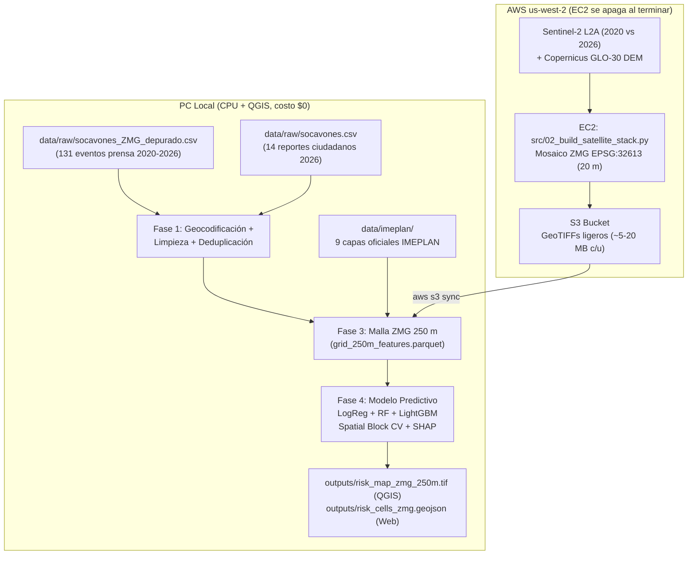

# Plan de Implementación — SocavonesGDL (Arquitectura Híbrida)

## Objetivo
Construir un pipeline geoespacial y de *Machine Learning* en **arquitectura híbrida** para predecir el riesgo de aparición de socavones en la **Zona Metropolitana de Guadalajara (ZMG)**, evaluando las tres causas principales:

1. **Cambio de uso de suelo y densificación urbana** (Sentinel-2 multi-temporal + IMEPLAN).
2. **Inundaciones y acumulación topográfica de agua** (Sentinel-2 lluvias + Copernicus DEM + Riesgo de inundaciones IMEPLAN).
3. **Saturación / falta de mantenimiento de tuberías y drenaje** (Red de drenaje municipal + Presión sobre el funcionamiento del drenaje IMEPLAN).

---

## Arquitectura Híbrida (AWS + Local)

- **AWS (`us-west-2`):** Solo se usa la EC2 para generar los GeoTIFFs satelitales (Sentinel-2 + Copernicus DEM) porque los COGs de Element 84 viven en `us-west-2`. Al terminar, se sincronizan a local (`aws s3 sync`) y la EC2 se puede **detener**.
- **Local (CPU + QGIS):** Procesamiento de CSVs, capas IMEPLAN, construcción de la malla 250 m, entrenamiento ML, análisis SHAP y visualización directa en QGIS.

---

## Inventario de Datos de Entrada (`data/raw/`)

| Archivo / Carpeta | Descripción | Notas clave |
|---|---|---|
| `data/raw/socavones_ZMG_depurado.csv` | 131 socavones de prensa verificados (2020–2026) | Sin `latitud`/`longitud` → se geocodifican en Fase 1 con auditoría de precisión. |
| `data/raw/socavones.csv` | 14 reportes ciudadanos (2026) | IDs 13 y 14 tienen coordenada default `20.67, -103.35` → se re-geocodifican. Se deduplican contra prensa. |
| `data/imeplan/*.zip` | 9 capas oficiales de IMEPLAN (`LimiteAMG`, `Crecimiento poblacional urbano 2010-2020`, `Densidad de población`, `Espacios verdes`, `Histórico de licencias de urbanización`, `Incremento al CUS`, `Transferencia de derechos de desarrollo`, `Riesgo de inundaciones`, `Presión sobre el funcionamiento del drenaje`, `Red de drenaje municipal`) | Las carpetas descomprimidas se ignoran en `.gitignore` (`data/imeplan/*/`) para mantener el repo liviano; los scripts leen tanto carpetas descomprimidas como `.zip`. *(Nota: `Riesgo de inundaciones.zip` pesa ~145 MB y supera el límite de 100 MB de GitHub, por lo que se recomienda sincronizarlo vía S3 o Git LFS.)* |

---

## Fases del Pipeline

### Fase 1 — Geocodificación, Limpieza y Unificación de Socavones (`src/01_prepare_sinkholes.py`)
- Unifica `socavones_ZMG_depurado.csv` (prensa) y `socavones.csv` (reportes ciudadanos).
- Geocodifica eventos sin coordenadas y corrige coordenadas genéricas (`20.67, -103.35`) con caché local (`data/interim/geocode_cache.json`).
- Clasifica cada punto por precisión (`exact_coords`, `intersection`, `street`, `colonia_centroid`, `unmatched`) y valida que caiga dentro de `LimiteAMG`.
- Deduplica eventos repetidos entre prensa y ciudadanos (< 100 m y < 45 días), preservando la columna `source` (`press_verified` vs `citizen_report`) y normalizando `causa_normalizada`.
- **Salidas:** `data/processed/sinkholes_clean.parquet`, `data/processed/sinkholes_clean.gpkg` (para auditar en QGIS) y `data/processed/geocode_audit.csv`.

### Fase 2 — Stack Satelital y Topográfico ZMG (`src/02_build_satellite_stack.py`)
- Corre en la **EC2 (`us-west-2`)** sobre la rejilla canónica `EPSG:32613` a **20 m/píxel** cubriendo toda la ZMG (`LimiteAMG`).
- Genera y sube a `s3://<bucket>/rasters/`:
  - **Cambio de uso de suelo (Sentinel-2 L2A):** `ndvi_2020.tif`, `ndvi_2026.tif`, `delta_ndvi_2020_2026.tif`, `ndbi_2020.tif`, `ndbi_2026.tif`, `delta_ndbi_2020_2026.tif`.
  - **Humedad e hidro-topografía (Sentinel-2 + Copernicus GLO-30 DEM):** `mndwi_wet_2026.tif`, `dem_elevation.tif`, `slope_deg.tif`, `tpi_local.tif`.
- Se descarga a local con `aws s3 sync s3://<bucket>/rasters/ data/processed/rasters/`.

### Fase 3 — Malla Espacial 250 m e Ingeniería de Variables (`src/03_build_grid_dataset.py`)
- Crea una malla regular de **250 m × 250 m** en `EPSG:32613` recortada a `LimiteAMG`.
- Cruza las 9 capas de IMEPLAN (drenaje, presión del drenaje, riesgo de inundación, licencias de urbanización, incremento CUS, transferencia de derechos, densidad/crecimiento poblacional, espacios verdes).
- Extrae estadísticas zonales (media y p90) de los GeoTIFFs satelitales/DEM.
- Asigna conteo y presencia de socavones (`sinkhole_count`, `has_sinkhole`, y separación `2020_2025` vs `2026`), usando solo eventos con precisión geográfica confiable (`exact_coords`, `intersection`, `street`).
- **Salidas:** `data/processed/grid_250m_features.parquet` y `data/processed/grid_250m_features.gpkg`.

### Fase 4 — Entrenamiento, Validación Espacial/Temporal y Mapa de Riesgo (`src/04_train_predict.py`)
- **Validación sin fuga (*leakage*):**
  1. **Spatial Block Cross-Validation** (5 folds en bloques de 4 km × 4 km).
  2. **Validación Temporal** (entrenar con 2020–2025 → evaluar cuántos socavones de 2026 caen en el Top-10% y Top-20% de celdas de mayor riesgo).
- **Modelos regularizados** (apropiados para ~140 positivos):
  - Regresión Logística L2 (baseline interpretable).
  - Random Forest regulado (`max_depth=5`, `min_samples_leaf=20`).
  - LightGBM regulado (`num_leaves=15`, `min_child_samples=30`).
- **Explicabilidad (SHAP):** Importancia agrupada por los 3 pilares causales (*Cambio de uso de suelo*, *Inundaciones/Topografía*, *Drenaje/Presión*) + top-3 factores por celda.
- **Salidas finales:**
  - `outputs/risk_map_zmg_250m.tif` (GeoTIFF de probabilidad 0–1 para **QGIS**).
  - `outputs/risk_cells_zmg.geojson` (polígonos con `risk_score`, `risk_tier` y `top_drivers` para la **página web**).
  - `outputs/model_report.md` y `outputs/shap_summary.png`.

---

## Verificación y Control de Calidad
- **Pruebas automatizadas (`pytest tests/`):** deduplicación y detección de coordenadas genéricas, alineación de rásters/malla, ausencia de fuga espacial/temporal en los folds.
- **Validación visual en QGIS:**
  1. `data/processed/sinkholes_clean.gpkg` sobre OpenStreetMap (Fase 1).
  2. `delta_ndbi_2020_2026.tif` y `tpi_local.tif` (Fase 2).
  3. `outputs/risk_map_zmg_250m.tif` con los socavones reales encima (Fase 4).
